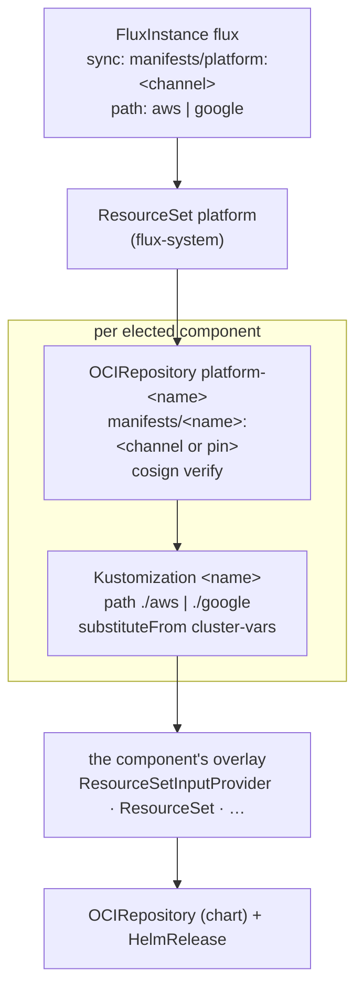

# Architecture

A cluster's FluxInstance syncs exactly one thing: the platform **entrypoint**. Everything else follows from it.

## From one sync to the whole platform

1. **The FluxInstance** (bootstrapped by the cluster module, then managed by the platform's own
   [flux](../components/flux.md) component) pulls `oci://<registry>/manifests/platform` at the cluster's channel tag,
   verifies its cosign signature, and applies the tree for the cluster's cloud (`platform/aws` or `platform/google`).
2. **That tree holds one object**: the `platform` ResourceSet. It reads the `PLATFORM_COMPONENTS` election and emits,
   for every component the cluster should run, an `OCIRepository` that pulls `oci://<registry>/manifests/<component>`
   and a `Kustomization` that applies the component's overlay for the cloud. The list of components in that ResourceSet
   is the dependency graph. See [Elections & the graph](graph.md).
3. **Each component's Kustomization** substitutes the `cluster-vars` ConfigMap into the overlay and applies it, waiting
   for health before anything that depends on it starts.
4. **Chart components** then list the mirrored chart versions in the platform registry, verify the chart's signature and
   install it with a HelmRelease. See [Chart delivery](chart-delivery.md).

## Why one image per component

Up to 3.x the whole repository shipped as one artifact. Splitting it buys three things:

- **Per-component pins.** A cluster can hold one component on a specific version (or try a newer one) with its
  `<NAME>_MANIFESTS_REF` variable, while everything else follows the channel. No platform release is needed to soak or
  hold back a single component.
- **Smaller blast radius.** A component's Kustomization only ever sees its own files, so a broken overlay fails one
  Kustomization rather than the whole tree.
- **A graph in one place.** Ordering, timeouts and election gates are data in the entrypoint, not scattered across
  per-component `dependsOn` fields.

Every image is signed with the same publish identity, and clusters verify every pull. See
[Signing & verification](signing.md).

## What the cluster module provides

The terraform cluster modules (`terraform-aws-eks-flux` and `terraform-google-gke-flux`) do the parts that have to exist
before Flux can run:

- Install flux-operator and the FluxInstance (bootstrap-only releases that the platform's `flux` and, on aws, `cilium`
  components adopt by name).
- Point the FluxInstance at `FLUX_SYNC_URL` and `PLATFORM_TREE`, on `FLUX_SYNC_CHANNEL`.
- Publish the `cluster-vars` ConfigMap: the full [contract](../reference/cluster-vars.md).
- Create cloud identities for the platform's ServiceAccounts (Workload Identity on GKE, Pod Identity or IRSA on EKS),
  DNS zones, static addresses, secret containers and, in KMS mode, the signing key's public half.
- Seed each application's own manifests (see [Applications](../applications.md)).

The namespace/ServiceAccount pairs those identity grants bind are pinned in the components' HelmRelease values; they're
listed on [Cluster variables](../reference/cluster-vars.md#workload-identity-contract).

## Two clouds, one shape

Both trees run the same core: kyverno and its signature policy, flux, cert-manager and its issuers, external-dns, the
Gateway and RBAC. They differ where the clouds do:

| concern          | aws                                                                                                  | google                                      |
| ---------------- | ---------------------------------------------------------------------------------------------------- | ------------------------------------------- |
| CNI + Gateway    | [cilium](../components/cilium.md) (adopted), Cilium Gateway                                          | GKE Dataplane V2, GKE managed Gateway       |
| load balancer    | [aws-load-balancer-controller](../components/aws-load-balancer-controller.md) → NLB on reserved EIPs | Google-managed global external ALB          |
| Gateway API CRDs | vendored in [gateway](../components/gateway.md), gated by `GATEWAY_API_CRDS`                         | shipped with GKE                            |
| secret sync      | [secret-sync](../components/secret-sync.md) controller + Secrets Store CSI add-on                    | GKE Integrated Secret Synchronization       |
| registry         | ECR (`ECRArtifactTag`, `OCI_PROVIDER=aws`)                                                           | Artifact Registry (`GARArtifactTag`, `gcp`) |
| DNS              | Route53, optional split-horizon private zone                                                         | Cloud DNS                                   |

How the per-cloud differences are kept out of the shared tier is covered in [Layout & cloud overlays](layout.md).
