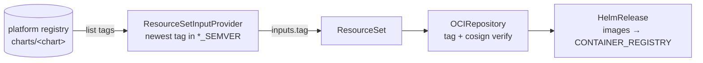

# Chart delivery

Most components install a helm chart that [flux-containers](https://oss.bitwisemedia.uk/flux-containers/) has mirrored
into the platform registry. They all follow one pattern, so a flux-containers publish rolls out on the next reconcile
without a change here.



## The input provider

A `ResourceSetInputProvider` lists the chart's tags in the platform registry and exports the newest one inside a semver
range:

```yaml
spec:
  type: "${ARTIFACT_TAG_PROVIDER:=GARArtifactTag}" # ECRArtifactTag on aws
  url: oci://${PLATFORM_REGISTRY}/charts/kyverno
  filter:
    semver: "${KYVERNO_SEMVER:=<4.0.0 >=3.8.0}"
    limit: 1
```

- **The range** has a default here and can be overridden per cluster with the `<NAME>_SEMVER` variable. Its floor should
  match the mirror's own `versionConstraint`; raising it can never pick a tag the mirror doesn't carry.
- **Ceiling first.** kustomize drops the quotes around the default during the build, and a plain scalar that starts with
  `>` is a YAML folded block scalar. Writing `<4.0.0 >=3.8.0` avoids that.
- **Auth is ambient.** The flux-operator ServiceAccount reads the registry through its cloud identity.
- It re-lists every 30 minutes (`fluxcd.controlplane.io/reconcileEvery`).

## The ResourceSet

The ResourceSet takes the provider's `tag` and emits the chart source and the release.

**The OCIRepository** pulls `oci://${PLATFORM_REGISTRY}/charts/<chart>` at that tag and verifies its cosign signature.
It sits in `resourcesTemplate` (a text template) rather than `resources`, because the _shape_ of its `verify` block
depends on the signing mode, and making a map key conditional needs a template:

```yaml
verify:
  provider: cosign
  << if $keyed >>
  secretRef:
    name: cosign-pub                 # KMS mode: the key's public half
  << else >>
  matchOIDCIdentity:
    - issuer: '${SIGNED_IDENTITY_ISSUER}'
      subject: '${SIGNED_IDENTITY_CHARTS}'
  << end >>
```

In KMS mode the same template also renders the `cosign-pub` Secret into the component's namespace from
`COSIGN_PUBLIC_KEY`. The identity values are single-quoted because they're regular expressions, and a double-quoted
scalar would mangle their backslashes. See [Signing & verification](signing.md).

**The HelmRelease** references the OCIRepository with `chartRef` and overrides every image `repository` to point at
`${CONTAINER_REGISTRY}/images/<upstream path>`, the mirrored copy. Kyverno only admits images the platform pipeline
signed, so a chart default that still points upstream would be blocked (or, in Audit mode, reported).

Common value conventions:

- **`nodeSelector: {role: system}`**: platform controllers run on the always-on system node pool, never on
  auto-provisioned workload capacity.
- **Pinned ServiceAccount names**: where terraform grants a cloud identity, the ServiceAccount name is fixed in values
  so the namespace/name contract holds.
- **CRDs `CreateReplace`** on install and upgrade, for charts that ship CRDs (kyverno, cert-manager, arc, secret-sync),
  so CRDs track the chart rather than helm's default of never upgrading them.

## Tracked images

Some images release faster than their charts. flux-containers tracks those independently of the chart (its
`.images.track` rule), and the component follows the mirrored image tags with a **second** input provider:

```yaml
url: oci://${PLATFORM_REGISTRY}/images/ghcr.io/dexidp/dex
filter:
  semver: "${DEX_IMAGE_SEMVER:=<3.0.0 >=2.44.0}"
```

The ResourceSet joins both providers with the `Permute` input strategy, which namespaces each provider's inputs by its
normalised name, and feeds the image pick into the HelmRelease:

```yaml
inputStrategy:
  name: Permute
inputsFrom:
  - { kind: ResourceSetInputProvider, name: dex }
  - { kind: ResourceSetInputProvider, name: dex-image }
# … ref.tag: << inputs.dex.tag >>   image.tag: << inputs.dex_image.tag >>
```

A tracked image bump published by the mirror then rolls out with no chart release, bounded by the `*_IMAGE_SEMVER`
variable. Keep that range aligned with the mirror's track rule. [dex](../components/dex.md) and
[external-dns](../components/external-dns.md) use this.

## Adopting bootstrap releases

Two components take over helm releases that terraform installed to bootstrap the cluster: [flux](../components/flux.md)
(flux-operator and the FluxInstance) and, on aws, [cilium](../components/cilium.md). terraform installs them with
`ignore_changes = all` and never touches them again. The platform's HelmRelease uses the **same release name in the same
namespace**, so helm-controller adopts the existing release storage instead of installing a second copy. From then on,
the chart version follows the mirror like every other component.

## Charts under management

| component                    | mirrored chart                                         | range variable                                     |
| ---------------------------- | ------------------------------------------------------ | -------------------------------------------------- |
| kyverno                      | `kyverno`                                              | `KYVERNO_SEMVER`                                   |
| flux                         | `flux-operator`, `flux-instance` (one tag drives both) | `FLUX_SEMVER`                                      |
| cilium                       | `cilium`                                               | `CILIUM_SEMVER`                                    |
| cert-manager                 | `cert-manager`                                         | `CERT_MANAGER_SEMVER`                              |
| aws-load-balancer-controller | `aws-load-balancer-controller`                         | `AWS_LOAD_BALANCER_CONTROLLER_SEMVER`              |
| external-dns                 | `external-dns` + tracked image                         | `EXTERNAL_DNS_SEMVER`, `EXTERNAL_DNS_IMAGE_SEMVER` |
| secret-sync                  | `secrets-store-sync-controller`                        | `SECRET_SYNC_SEMVER`                               |
| dex                          | `dex` + tracked image                                  | `DEX_SEMVER`, `DEX_IMAGE_SEMVER`                   |
| arc                          | `gha-runner-scale-set-controller`                      | `ARC_SEMVER`                                       |

The defaults for each range are on the component pages and in [Cluster variables](../reference/cluster-vars.md).

## First-party charts

[dex-client-controller](../components/dex.md#dex-client-controller), in the dex component, is the one chart that isn't
mirrored. It's first-party: its own release workflow publishes the chart and image to ghcr and signs both, so mirroring
would only re-sign an artifact whose provenance is already known. Its input provider lists ghcr directly
(`type: OCIArtifactTag`, anonymous, range `DEX_CLIENT_CONTROLLER_SEMVER`), its OCIRepository uses `provider: generic`
and is always verified keylessly against the controller repository's own identity (a KMS-keyed cluster's key never
signed it), and the release runs the chart's default ghcr image. Because that image carries a different identity from
the platform's, the dex component also ships the image exception and policy for it, following
[an application's own image signer](../applications.md#its-own-image-signer).
