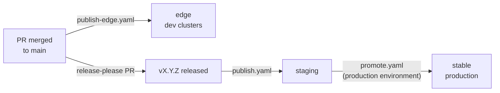

# Daily workflow

Most changes touch one component: a value in its HelmRelease, a new cluster variable, a policy tweak. The loop is the
same every time. Edit, render everything locally the way a cluster would, open a PR, and let the channels carry the
change from dev clusters to production.

## 1. Edit

Find the component under `components/<name>/`. Shared behaviour goes in `common/`; anything only one cloud needs goes in
that cloud's overlay (`aws/` or `google/`). The rules for which is which are in
[Layout & cloud overlays](../concepts/layout.md). Ordering, timeouts and election gates are not in the component at all:
they live in the entrypoint, `platform/<tree>/resourceset.yaml` ([Elections & the graph](../concepts/graph.md)).

If the change reads a new cluster variable, add it to the env contract in `tests/` too, and to the
[Cluster variables](../reference/cluster-vars.md) page. The harness only knows a variable exists if one of the env files
publishes it.

## 2. Validate

```sh
make test   # render + guard + kubeconform every tree, both signing modes
make lint   # license headers, prose, workflows, shell, kubescape over the overlays
```

`make test` is the important one. It builds every component overlay and both entrypoints four times
(`{google,aws} × {keyless,keyed}`), substitutes the env contract exactly as kustomize-controller would, renders every
ResourceSet with the fixtures in `tests/inputs/`, runs the structural guards and kubeconforms the result. When it fails,
the message names the file and the rule. [Validation](../concepts/validation.md) explains each guard.

`make pr` runs `fmt`, `lint`, `test` and the docs build in one go. Run it before opening a pull request.

## 3. Open a pull request

Commit with a [Conventional Commit](https://www.conventionalcommits.org/) message scoped to the component, for example
`fix(dex): …` or `feat(gateway): …`. release-please derives the next version and the changelog from these, so the prefix
decides whether the change is a patch, a minor or (with `!`) a major release. A change that breaks the cluster-vars
contract or removes a component is a breaking change.

CI runs `lint`, `test` and the docs `build` as separate jobs. The repository merges by fast-forward: a maintainer
comments `/merge` on an approved, green PR, or arms it with `/auto-merge`. Don't use the merge button.

## 4. Follow it through the channels



1. **Edge.** Every merge to main is pushed and signed as `edge` within minutes. Clusters on the `edge` channel pick it
   up on their next reconcile.
2. **Staging.** release-please keeps a release PR open. Merging it cuts `vX.Y.Z`, and the publish workflow pushes every
   image at that version and moves `staging` onto it.
3. **Stable.** After the release has soaked on staging, run the **Promote Manifests** workflow with the version. It's
   gated by the `production` environment and moves `stable` onto the same signed digests.

Details, including the signing identity each channel carries, are in [Releases & channels](../concepts/releases.md).

!!! tip "Soak one component on one cluster"

    To hold a single component back, or to try a component's new version on one cluster first, set its
    `<NAME>_MANIFESTS_REF` cluster variable to a version tag. That component then ignores the cluster's channel until
    the variable is removed. See [Operations](../reference/operations.md#pinning-a-component).

## 5. Keep the docs current

If the change alters what a component deploys, its dependencies, the variables it reads or how something works, update
the matching page under `docs/` in the same PR. Component pages embed the manifests themselves, so the source listings
are always current, but the prose around them is not. Preview with `make serve` (<http://localhost:8004>).
