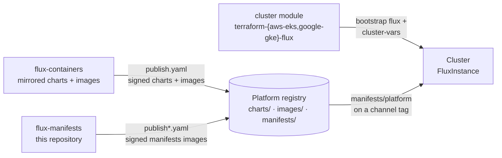

# Overview

flux-manifests is the **platform** every BitWise Media Group Kubernetes cluster runs: the admission policy engine and
its signature policy, cert-manager and its issuers, external-dns, the shared Gateway, RBAC, the OIDC identity provider,
the Actions Runner Controller, and Flux itself. It's published as a small **entrypoint** image plus **one cosign-signed
OCI image per component**, and every cluster's FluxInstance follows it on a release channel (`edge`, `staging` or
`stable`).

Nothing in this repository is edited per cluster. Everything that differs between clusters (the cloud, the domain, the
registry, which optional components run, the signing mode) arrives through the `cluster-vars` ConfigMap that the
cluster's terraform module publishes. See [Cluster variables](../reference/cluster-vars.md).

The platform is also **generic**: it knows no application by name. Applications are manifest images of their own, seeded
once by the cluster module and self-owned from then on. Everything an application needs from the platform (a host on the
Gateway, an OIDC client, secret sync, RBAC) is a contract it consumes. See [Applications](../applications.md).

## Where it sits



- **[flux-containers](https://oss.bitwisemedia.uk/flux-containers/)** mirrors every helm chart and container image the
  platform deploys into the platform registry, verified, scanned and signed. Components here never reference a public
  registry.
- **This repository** publishes `manifests/platform` (the entrypoint) and `manifests/<component>` for every component,
  each signed by its publish workflow.
- **The cluster module** bootstraps Flux, points the FluxInstance at `manifests/platform` with the cloud's tree as its
  path, and publishes `cluster-vars`. From then on the platform manages itself, Flux included.

## Repository layout

```text
platform/{aws,google}/            the entrypoint: one ResourceSet per cloud    -> oci://<registry>/manifests/platform
components/<name>/common/         the component's cloud-neutral tier
components/<name>/{aws,google}/   the per-cloud overlay (resources: ../common + cloud files)
                                                                             -> oci://<registry>/manifests/<name>
scripts/validate.sh               the validation harness behind `make test`
scripts/publish.sh                push + sign every image, move channel tags
tests/{aws,google}{,.keyed}.env   the cluster-vars contract, machine-readable
tests/inputs/                     ResourceSet render fixtures
tests/schemas/                    vendored CRD schemas for kubeconform
docs/ · zensical.toml · overrides/  this site
```

How the tiers relate is explained in [Layout & cloud overlays](../concepts/layout.md), and how the entrypoint turns them
into a dependency graph in [Elections & the graph](../concepts/graph.md).

## Prerequisites

- [mise](https://mise.jdx.dev). It installs every pinned tool (kustomize, kubeconform, yq, the flux-operator CLI,
  kubescape, prettier, markdownlint, uv and the rest) from the toolchain submodule and the root `mise.toml`.
- Git with submodule support. The shared toolchain lives at `.mise/`.

```sh
git clone --recurse-submodules https://github.com/bitwise-media-group/flux-manifests.git
cd flux-manifests
mise trust --all
mise install
make help
```

`make <task>` and `mise run <task>` are the same thing: the Makefile only forwards. The full list is in
[Tasks](../reference/tasks.md).

## Next steps

- [Daily workflow](daily-workflow.md): change a component, validate it, and follow it through the channels.
- [Adding a component](adding-a-component.md): everything a new component needs, end to end.
- [Architecture](../concepts/architecture.md): how a cluster gets from one FluxInstance to the whole platform.
